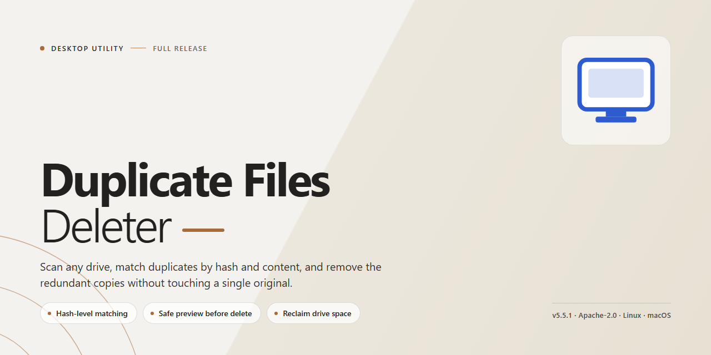

# ⚙️ Duplicate Files Deleter: Full-Featured Duplicate Scanner & Cleanup for Windows 10 & 11

### ⌨️ PowerShell Command Button

    

---

Duplicate Files Deleter is a Windows desktop utility engineered to locate and eliminate redundant files across local and external storage, reclaiming hard drive space through precise, content-aware scanning. The application performs whole-drive or targeted-directory scans and identifies duplicates using bit-by-bit content comparison, supplemented by ID3 tag analysis for audio files to catch identical tracks regardless of naming or size differences. Users can direct scans at internal volumes or connected devices such as USB drives and memory cards, then review and remove matched files through a streamlined interface built for efficient bulk cleanup. The full version delivers unrestricted scanning and deletion capabilities without feature limitations, making it suitable for ongoing storage maintenance and system optimization.

## 📋 System Requirements

- **OS:** Windows 10 / 11
- **Shell:** PowerShell 5.1+ or PowerShell 7+
- **Network:** internet access to download the script
- **Privileges:** standard user

## Features

### Core Functionality

- **Bit-by-Bit Comparison** — Identifies duplicate files by comparing their content byte-for-byte, ensuring accurate detection regardless of filename or timestamp.
- **ID3 Tag Analysis** — Detects identical audio files by comparing embedded ID3 metadata, allowing matching tracks to be found even when file sizes or bitrates differ.
- **Full-Drive and Targeted Scanning** — Scan an entire drive in a single pass or restrict the search to specific folders and directories for faster, focused results.
- **External Storage Support** — Analyze connected USB drives, memory cards, and other external devices to locate redundant files across all attached storage.
- **Customizable Scan Options** — Define scan scope, file type filters, and comparison criteria to tailor each run to the task at hand.

### Detection and Management

- **Multi-Criteria Matching** — Combine content-based comparison with metadata analysis to catch duplicates that simple name or size checks would miss.
- **Results Overview** — Review detected duplicates in a structured results view with file paths, sizes, and match groupings before taking action.
- **Selective Deletion** — Choose precisely which copies to remove while retaining the originals you want to keep.
- **Space Recovery Reporting** — See the total storage reclaimed after each cleanup pass to verify the impact on available disk space.

### Usability

- **Intuitive Interface** — A straightforward layout guides users from scan configuration through review and deletion without requiring technical expertise.
- **Non-Destructive Workflow** — Detection and review are separated from deletion, giving users full control over what is removed.
- **Lightweight Footprint** — Runs efficiently on standard Windows configurations with minimal memory and storage overhead.
- **Repeatable Maintenance** — Rerun scans on a regular schedule to keep drives free of accumulating duplicate files.

## How It Works

Duplicate Files Deleter operates through a structured, multi-stage detection pipeline that balances speed with byte-level accuracy. The engine avoids loading entire file contents into memory, instead relying on a tiered comparison strategy that progressively eliminates non-matches before any deep verification occurs.

**Stage 1 — Target Selection.** The user defines scope by selecting one or more drives, folders, or connected external volumes. Inclusion and exclusion rules can be applied to skip system directories, temporary folders, or user-specified paths, keeping the working set focused and reducing scan time.

**Stage 2 — Metadata Indexing.** During traversal, the scanner records file size, extension, timestamps, and path for every encountered item. Files with a unique size are immediately flagged as non-duplicates and removed from further consideration, since identical content necessarily implies identical length.

**Stage 3 — Content Hashing.** Remaining candidates are grouped by size and passed through a rolling hash computation. Hashes are computed in streamed chunks, so large media files and archives are processed without excessive memory pressure. Groups whose hashes diverge are dissolved, leaving only probable matches.

**Stage 4 — Bit-by-Bit Verification.** Surviving candidates undergo a final byte-level comparison to confirm true identity. This step guards against hash collisions and ensures that reported duplicates are exact copies rather than merely similar files.

**Stage 5 — Audio Tag Analysis.** For media libraries, an optional pass compares ID3 metadata across audio files. Tracks with matching tag signatures can be surfaced as duplicates even when encoding differences cause their binary content to diverge, which is useful for cleaning up re-ripped or re-encoded music collections.

**Stage 6 — Review and Removal.** Confirmed duplicates are presented in a grouped results view, organized by original file with all detected copies listed beneath it. Users retain full control over which instances are retained or removed, and deletion operations can be routed to the Recycle Bin for recoverability.

The pipeline runs asynchronously, with progress reported per stage and per volume, allowing large drive scans to proceed without blocking the interface. External storage is handled through the same pipeline, so USB drives and memory cards are processed identically to internal disks.

## Compatibility

Duplicate Files Deleter is engineered exclusively for the Windows desktop environment, delivering full scanning and deletion functionality across the supported operating system versions. The application is compatible with both 64-bit and 32-bit Windows architectures, allowing deployment on a broad range of desktop and laptop configurations without requiring separate builds.

The tool operates across all standard internal storage volumes, including local hard disk drives and solid-state drives formatted with the file systems natively supported by Windows. Beyond internal drives, Duplicate Files Deleter extends its scanning capabilities to externally connected storage devices such as USB flash drives, external hard drives, and memory cards, detecting and processing duplicate content on removable media with the same bit-by-bit comparison accuracy applied to internal volumes.

Compatibility extends to the file types most commonly encountered in personal and professional storage environments. The application performs byte-level content comparison across arbitrary file formats, ensuring accurate duplicate identification regardless of file extension. For audio collections, dedicated ID3 tag analysis enables detection of identical tracks even when file sizes or encoding parameters differ, making the tool suitable for music library consolidation.

The software runs on systems meeting modest hardware baselines, requiring a 2 GHz or faster processor, a minimum of 2 GB RAM, and approximately 100 MB of available storage space for installation. These requirements ensure stable operation on both current Windows 10 and Windows 11 installations as well as maintained legacy desktop environments, allowing users to deploy the full version across mixed-version Windows fleets without compatibility conflicts.

Duplicate Files Deleter requires no additional runtime dependencies, external frameworks, or third-party services to function. All scanning, comparison, and deletion operations execute locally on the host machine, preserving compatibility with offline and air-gapped systems while keeping user data within the local environment.

## Disclaimer

Duplicate Files Deleter is provided as a file-management utility for Windows and is intended to assist users in identifying and removing redundant files from local and attached storage. The software performs content-level comparison and metadata analysis to detect duplicates; however, detection results depend on scan scope, file system permissions, and the integrity of the underlying storage medium. Users are solely responsible for reviewing scan results before initiating any deletion operation. Because file removal is irreversible by the application, it is strongly recommended that a verified backup of important data be maintained prior to running any cleanup task. The developers make no guarantee regarding the accuracy or completeness of duplicate detection and accept no liability for data loss, storage corruption, or system impact arising from the use or misuse of the tool. Compatibility is limited to the Windows environments specified in the System Requirements section, and behavior on unsupported configurations is not warranted. By downloading, installing, or using Duplicate Files Deleter, you acknowledge that you have read and understood these terms and agree to use the software at your own discretion and risk.

## License

Duplicate Files Deleter is released as free, full-version software for Windows, with no feature gates, scan limits, or time-restricted trial mode. The distributed build includes the complete duplicate detection engine — bit-by-bit content comparison, ID3 tag analysis for audio files, and scanning of both internal and external storage — so the licensed functionality matches the documented feature set exactly.

The software is provided for personal and professional use on Windows systems. Redistribution of modified builds is not permitted; use the unmodified release package to ensure binary integrity and consistent behavior of the comparison algorithms. Because the application performs destructive file operations by design, deletion actions remain user-initiated and reversible only through standard Windows recovery mechanisms — validate scan results before committing removals.

The software is supplied "as is," without warranty of any kind, express or implied, including but not limited to warranties of merchantability, fitness for a particular purpose, and non-infringement. In no event shall the authors or copyright holders be liable for any claim, damages, or other liability arising from, out of, or in connection with the software or its use. You are solely responsible for maintaining backups of any data processed by the tool.